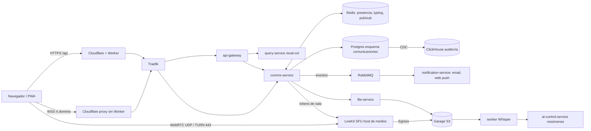

# Plan: módulo de Comunicaciones estilo Discord

> Documento de análisis y propuesta. No implica cambios aplicados. Todo cambio de esquema en `sso` requiere **aprobación explícita** antes de escribir migraciones.

## Índice
1. [Resumen ejecutivo](#1-resumen-ejecutivo)
2. [Inventario: qué existe hoy](#2-inventario-qué-existe-hoy)
3. [Funcionalidades de Discord y su encaje escolar](#3-funcionalidades-de-discord-y-su-encaje-escolar)
4. [Arquitectura objetivo](#4-arquitectura-objetivo)
5. [Modelo de datos propuesto (requiere aprobación)](#5-modelo-de-datos-propuesto-requiere-aprobación)
6. [Permisos, seguridad y protección de menores](#6-permisos-seguridad-y-protección-de-menores)
7. [Funcionalidades por niveles](#7-funcionalidades-por-niveles)
8. [Fases, esfuerzo y riesgos](#8-fases-esfuerzo-y-riesgos)
9. [Estructura en OpenSpec](#9-estructura-en-openspec)
10. [Decisiones abiertas](#10-decisiones-abiertas)
11. [Centro de notificaciones general (prerrequisito)](#11-centro-de-notificaciones-general-prerrequisito)
12. [Push real con notification-service](#12-push-real-con-notification-service)
13. [Plan spec-driven OpenSpec detallado](#13-plan-spec-driven-openspec-detallado)
14. [Despliegue self-hosted](#14-despliegue-self-hosted)

---

## 1. Resumen ejecutivo

- El front (`origin/dev`) ya tiene un **prototipo amplio solo-mock** en `src/features/comunicaciones/chat` (canales, DMs, adjuntos, fijados, edición, búsqueda local, comunicados, encuestas, elecciones, evaluaciones, votación rápida, borradores, notificaciones). Los tipos dicen literalmente: *"El backend aún no existe: la forma la fija el mock"*.
- El backend `sso` **no tiene** tablas, funciones ni endpoints de chat, ni WebSocket/STOMP/SSE en ningún servicio. El gateway usa *polling* deliberadamente (comentario en `CatalogRoutesRefresher`).
- Sí hay piezas reutilizables: **RabbitMQ** + **notification-service** (email real: SMTP/Resend/EmailJS; SMS Twilio/Vonage; push solo FCM (SaaS) o fake, sin inbox), **file-service + Garage (S3)**, **ai-control-service** (OpenAI), **Redis**, **Traefik**, CDC→ClickHouse para auditoría.
- Propuesta: un **nuevo microservicio `comms-service`** (Spring Boot, WebSocket nativo con fan-out por Redis Pub/Sub o RabbitMQ) para tiempo real; persistencia en Postgres con un esquema nuevo `comunicaciones`; REST para todo lo que no sea evento en vivo.
- Medios (voz/video/pantalla/grabación): **LiveKit self-hosted** (SFU + Egress a Garage) con TURN embebido, **en un host aparte o con IP pública/UDP directa** — Cloudflare Workers/proxy no transportan UDP/WebRTC.
- **Requisito duro: todo self-hosted, sin SaaS de terceros** (ni Twilio/Agora/Daily/LiveKit Cloud, ni OpenAI, ni Pusher/Ably, ni OneSignal, ni buckets en la nube, ni STUN de Google en producción). Única excepción inevitable: los *push services* de los navegadores (FCM/Mozilla/Apple) como transporte de Web Push, con payload cifrado y mínimo (§12).
- Transcripción: **faster-whisper self-hosted** en un worker propio. Resúmenes con un **LLM local** (Ollama/vLLM) detrás de ai-control-service — hoy ai-control-service usa OpenAI, así que esto exige agregarle un proveedor local.
- MVP realista: 8–10 semanas (texto, DMs, menciones, reacciones, adjuntos, no leídos, notificaciones in-app). Voz/video: +6–8 semanas. Grabación+transcripción: +4–6 semanas.

- **Prerrequisito**: un **Centro de notificaciones general** (bandeja persistente, campana, `/app/notificaciones`, preferencias y Web Push real sobre notification-service) se construye **primero** como capability propia de la que depende el chat (§11–§13).
- Todo se ejecuta **spec-driven con OpenSpec** (§13). Siguiente paso: scaffold de los changes en `openspec/` (aún no creado).

## 2. Inventario: qué existe hoy

### 2.1 Front (`origin/dev`, el checkout local está atrás)

| Pieza | Ubicación | Estado |
|---|---|---|
| Ruta `comunicaciones/chat` → `ChatPage` | `router.tsx`, `features/comunicaciones/chat/pages/chat-page.tsx` | Funciona solo con MSW |
| Tipos de dominio | `chat/api/types.ts` | `Conversacion` (CANAL/DIRECTO, categorías GENERAL/VOTACION/ENCUESTA/EXAMEN/ANUNCIO, silencio, archivada), `Mensaje` (editado, fijado, sistema, adjunto, votación), `ArchivoCompartido`, `Candidato`… |
| Queries | `chat/api/query/*` (conversaciones, mensajes, miembros, archivos, borradores, comunicados, encuestas, elecciones, evaluaciones, votantes, personas, notificaciones) | `evalCol.getRows("/comunicaciones/...")`; tiempo "real" por `refetchInterval` (notificaciones 60 s, solo con mocks) |
| Mutaciones | `chat/api/mutations/*` (mensaje, conversación, miembro, archivo, borrador, comunicado, elección, encuesta, evaluación, votación rápida) | Contra MSW |
| Componentes | composer, editor de texto, `texto-formateado` + `html-seguro` (sanitizado), `buscador-mensajes` (búsqueda en cliente), `crear-eleccion-dialog`, `notificaciones-chat` (campana) … | UI madura, reutilizable |
| Permisos | `chat/api/use-chat-access.ts` | Por revisar contra `useMenuPermission` |
| Mocks | `src/mocks/db/comunicaciones-*.ts` + handlers | Única "fuente de verdad" del contrato |
| Tests | `chat/lib/*.test.ts` (no corren en CI, ver CLAUDE.md §1) | |
| Asistente IA | `features/assistant` con `@tanstack/ai-react` y `mock-chat.ts` | Sin backend |
| Tiempo real | Ningún `WebSocket`/`EventSource`/STOMP en `src` | — |
| Offline | `openspec/changes/add-offline-*` | Chat no está contemplado |

**Implicación**: el contrato actual es camelCase de dominio dictado por el mock. Al conectar backend real habrá que introducir filas snake_case + mapeadores `toXxx` (patrón §7 de CLAUDE.md) y probablemente renombrar endpoints.

### 2.2 Backend `sso`

| Servicio | Relevancia |
|---|---|
| `api-gateway` (Spring Cloud Gateway) + `traefik` | SCG soporta proxy WebSocket (`ws://`/`lb:ws://`); hoy no hay rutas WS. Traefik también lo soporta. |
| `auth-center` | JWT; el token vive **en memoria** del front → para WS hay que mandarlo en el primer frame o como query param de un ticket corto (no en cookie). |
| `query-service-postgres` | Motor `/eval-col/*` (SQL declarativo). Sirve para lecturas/escrituras REST del chat, no para tiempo real. |
| `notification-service` + `rabbitmq` | Canales con `ProviderRegistry`; email real (SMTP/Resend/EmailJS); **push y SMS solo fake** → falta Web Push (VAPID) / FCM. |
| `file-service` + `garage` | Multipart, view tokens de 5 min → adjuntos y grabaciones. Sin antivirus. |
| `ai-control-service` | Usa OpenAI; prompts en `resources/prompts`. Base para resúmenes. |
| `redis` | Útil para presencia, typing, pub/sub y rate-limit. |
| `cdc-*` + ClickHouse | Auditoría de cambios: cubre moderación/forense de mensajes. |
| Migraciones | Ninguna de chat/mensajes/comunicaciones. |

### 2.3 Infra y sus consecuencias

- Prod/test: **un host Docker** detrás de Cloudflare; el Worker reenvía `/api/*`.
- **WebSocket por el Worker**: posible (el Worker puede hacer `fetch` con `Upgrade: websocket` y devolver el socket), pero cada conexión cuenta como una request de larga duración; hay que verificar el plan (límites de duración/CPU, cierres en redeploy). Alternativa más limpia: subdominio `rt.<dominio>` **proxied por Cloudflare (orange cloud) sin Worker**, que soporta WS de forma nativa.
- **WebRTC**: usa UDP (y TCP/TLS 443 de respaldo). Cloudflare proxy y Workers **no** pasan UDP. El SFU necesita IP pública con puertos UDP abiertos (p. ej. 50000–60000) y TURN/TLS en 443 para redes escolares restrictivas. Un subdominio **gris (DNS only)** apuntando al host de medios.
- **Ancho de banda**: una clase de 30 con video 360p simulcast ≈ 30 × ~0,5 Mbps de bajada + 1–2 Mbps por publicador. 5 clases simultáneas ≈ 100+ Mbps de egress → **no mezclar con el host de la app**.
- **Almacenamiento**: grabación 720p ≈ 0,5–1 GB/h. 50 h/semana ≈ 2 TB/año → política de retención obligatoria.

## 3. Funcionalidades de Discord y su encaje escolar

| Funcionalidad Discord | ¿Construir? | Adaptación escolar |
|---|---|---|
| Servidores | Sí, adaptado | "Espacios" = institución, sede, grado/grupo, asignatura, comité. Se crean **automáticamente** desde la estructura académica (grupo → espacio con estudiantes y docentes). |
| Canales de texto | Sí | Con modo "solo anuncios" (solo docentes escriben). |
| Categorías de canales | Sí | Agrupar canales en un espacio. |
| Foros (hilos con título/etiquetas) | Sí (v2) | Dudas por tema/tarea; etiquetas "resuelta". |
| Hilos (threads) | Sí (v2) | Respuestas a un mensaje. |
| Respuestas citadas | Sí (MVP) | |
| DMs y grupos DM | Sí, restringido | Docente↔acudiente, docente↔docente; **estudiante↔estudiante configurable** (por defecto desactivado o visible para moderación). |
| Menciones @usuario/@rol/@everyone/@here | Sí | @everyone solo para roles con permiso; @rol mapea a roles del SSO o "docentes del grupo". |
| Reacciones emoji | Sí | Set de emojis curado; sin emojis personalizados en MVP. |
| Fijados, editar, borrar | Sí | Borrado lógico; historial de edición visible a moderadores. |
| Adjuntos, previsualización | Sí | Límite de tamaño, tipos permitidos. |
| Indicador "escribiendo", presencia | Sí | Presencia por espacio; estado "en clase/no molestar". |
| No leídos, menciones, campana | Sí | |
| Búsqueda con filtros (`from:`, `in:`, `has:`) | Sí | Encaja con la sintaxis Gmail ya existente (`components/search/query-syntax.ts`). |
| Canales de voz | Sí (v2) | "Salas" de tutoría/reunión. |
| Llamadas de voz/video | Sí (v2) | |
| Compartir pantalla | Sí (v2) | Docente por defecto; estudiantes con permiso. |
| Stage channels | Sí (v3) | "Clase magistral / asamblea": pocos hablantes, muchos oyentes, levantar la mano. |
| Eventos programados | Sí (v3) | Reuniones de padres, clases; integrable con calendario/horario. |
| Encuestas | **Ya existe** (prototipo) | Integrar como tipo de mensaje. |
| Grabación + transcripción + resumen | Sí (v3) | No es nativo de Discord; alto valor escolar. |
| Moderación (AutoMod, reportes, timeouts, slowmode) | Sí | Filtro de palabras, reporte, silenciar, slowmode. Crítico con menores. |
| Roles y permisos por canal | Sí, simplificado | Derivados del SSO + overrides por canal. |
| Bots / webhooks / slash commands | Parcial (v3) | Bot del sistema (avisos de notas, asistencia, tareas del planeador). Sin bots de terceros. |
| Nitro, boosts, stickers, soundboard, actividades/juegos, perfiles personalizables, servidores públicos/descubrimiento, invitaciones por enlace abierto, Go Live público | **No** | Comercial o riesgo con menores. Invitaciones solo internas. |
| Mensajes de voz | Opcional (v3) | Útil en preescolar/acudientes. |
| Mensajes programados / recordatorios | Sí (v2) | Docentes. |
| Confirmación de lectura | Sí para comunicados | Ya modelado en "comunicado". |

## 4. Arquitectura objetivo



### 4.1 Mensajería en tiempo real

| Opción | Pros | Contras | Veredicto |
|---|---|---|---|
| **A. `comms-service` dedicado con WebSocket nativo (JSON propio) + Redis pub/sub** | Control total, escala horizontal, desacoplado del motor de queries | Servicio nuevo que mantener | **Recomendada** |
| B. STOMP sobre relay RabbitMQ (plugin `rabbitmq_stomp`/Web-STOMP) | Reutiliza RabbitMQ; protocolo estándar | Autorización por destino más torpe; exponer el broker | Alternativa |
| C. SSE (server→cliente) + REST para enviar | Simple, pasa por HTTP/Worker sin problemas | Unidireccional; typing por POST; menos eficiente | Plan B si WS por Cloudflare da problemas |
| D. Polling (hoy) | Cero infra | Latencia/carga inaceptables para chat | Solo prototipo |
| E. Centrifugo self-hosted (con Redis) | Servidor WS probado, presencia/historial incluidos, el backend publica por API | Otro componente; auth por JWT propio de Centrifugo | Alternativa seria a A |
| F. SaaS (Stream, Ably, Pusher) | — | Prohibido por requisito self-hosted | Descartado |

Detalles:
- **Auth WS**: el front pide `POST /comms/ws-ticket` (Bearer) → ticket de 30 s de un solo uso → `wss://rt…/ws?ticket=`. Reautenticar al refrescar token.
- Eventos: `message.created|updated|deleted`, `reaction.*`, `typing`, `presence`, `read.updated`, `channel.*`, `call.*`. Cada evento lleva `seq` por canal para reconciliar con TanStack Query (`setQueryData` en mensajes; invalidar en reconexión con `?after=seq`).
- Escrituras por REST (idempotentes con `clientMessageId`) y el WS solo difunde → mensajes optimistas en el front.
- **Escala**: colegio típico 500–2.000 usuarios, concurrencia pico 10–20 % (100–400 sockets). Con 50 colegios ≈ 20.000 sockets: 2 réplicas de `comms-service` sobran.

### 4.2 Persistencia
Postgres (esquema `comunicaciones`), particionado por mes de `mensaje` cuando supere ~50 M filas. Lecturas paginadas por cursor (`id < :before`), no offset. ¿Usar el motor `/eval-col` para el CRUD? Posible para catálogos/configuración; para mensajes conviene `comms-service` (necesita publicar eventos tras commit — patrón outbox).

### 4.3 Búsqueda
- **Postgres FTS** (`tsvector` con config `spanish` + `unaccent`, índice GIN) — **recomendado**: cero infra, filtrado por permisos en SQL.
- OpenSearch/Meilisearch: solo si el volumen o la relevancia lo exigen (v3+).

### 4.4 Adjuntos
file-service + Garage. Añadir: lista blanca de MIME, límite (p. ej. 25 MB), miniaturas, y **ClamAV** como contenedor para escanear antes de publicar (recomendado con menores). Visualización con view tokens existentes (`useArchivoViewUrl`).

### 4.5 Notificaciones
- In-app: contadores de no leídos/menciones por WS + campana (`notificaciones-chat.tsx` ya existe).
- **Web Push (VAPID)**: ver §12 (hoy existen `FcmPushProvider` y `FakePushProvider`; se agrega `WebPushProvider` VAPID propio) + service worker (encaja con el plan offline/PWA). Respeta silencios y horario escolar ("no molestar" 8 pm–6 am para estudiantes).
- Email: resumen diario de menciones no leídas (provider ya existe).
- Móvil nativo: fuera de alcance; PWA cubre Android y iOS ≥16.4 (instalada).

### 4.6 Medios: voz, video, pantalla

| Opción | Pros | Contras | Costo orientativo |
|---|---|---|---|
| **LiveKit self-hosted** | SFU moderno, SDK React, simulcast, TURN embebido, Egress (grabación) e Ingress, webhooks, tokens JWT | Operar host de medios con UDP | VPS 8 vCPU/16 GB + ancho de banda (~USD 80–200/mes) |
| Jitsi Meet (self-hosted) | Producto completo, gratis | Integración/UI propia difícil, grabación (Jibri) pesada | Similar |
| mediasoup / Janus | Máxima flexibilidad | Construir señalización, grabación y UI encima | Mucho desarrollo |
| LiveKit Cloud / Daily / Twilio / Agora | — | Prohibidos (SaaS) | Descartados |

**Recomendación**: **LiveKit server OSS self-hosted en host separado** (piloto y producción), con **coturn propio** (STUN+TURN UDP 3478 y TURN/TLS 5349 o 443) — sin STUN de Google: los `iceServers` del token apuntan solo a nuestro coturn. `comms-service` emite tokens de sala según permisos. UI con `@livekit/components-react` estilizada con tokens propios.

### 4.7 Grabación, transcripción y resúmenes
- LiveKit **Egress** (room composite) → MP4 en Garage (S3) → evento → worker de transcripción.
- **faster-whisper self-hosted** (modelo `medium`/`large-v3` en GPU ≈ 10–20× tiempo real; en CPU `small` ≈ 1× tiempo real): datos no salen; costo fijo. **Recomendado** por tratarse de menores (Ley 1581 de 2012: datos de niños son sensibles, requieren autorización de representante y finalidad clara).
- whisper.cpp como alternativa en CPU pura. **API de OpenAI descartada** (requisito self-hosted).
- Diarización (pyannote, local) opcional.
- Resumen: ai-control-service con un **proveedor LLM local nuevo** (Ollama o vLLM con un modelo abierto ~7–8B en español, p. ej. Llama 3.x / Qwen) — la integración OpenAI actual no se usa para este módulo.
- Aviso visible "Grabando" + consentimiento previo + retención configurable.

### 4.8 Integración con el front
- Mantener `features/comunicaciones/chat`; crear `features/comunicaciones/realtime` (cliente WS, provider, reconexión) y `features/comunicaciones/llamadas`.
- TanStack Query sigue siendo la caché: el WS solo parchea (`setQueryData`) e invalida.
- Mensajes: `useInfiniteQuery` con cursor.
- Base UI/shadcn existentes; íconos vía `@/components/ui/icons`.
- Offline: chat **online-only**; lectura de últimos N mensajes cacheados (persistencia de Query del plan offline) y cola de envío opcional en v2. Llamadas, nunca.
- Quitar ramas mock por `env.ENABLE_API_MOCKING` progresivamente, conservando MSW para el entorno `dev`.

## 5. Modelo de datos propuesto (requiere aprobación)

> ⚠ **Cambio de esquema**: no crear migraciones sin OK explícito. Esto es solo propuesta.

| Tabla | Campos clave |
|---|---|
| `tespacio` | pk, fk_establecimiento, tipo (INSTITUCION/SEDE/GRUPO/ASIGNATURA/LIBRE), fk_origen (grupo, asignatura…), nombre, icono, archivado |
| `tcanal` | pk, fk_espacio (null en DM), tipo (TEXTO/ANUNCIOS/FORO/VOZ/STAGE/DM/GRUPO_DM), categoria, nombre, tema, slowmode_seg, posicion, archivado |
| `tcanal_miembro` | fk_canal, fk_usuario, rol_canal, silenciado_hasta, ultimo_leido_msg, menciones_pendientes |
| `tcanal_permiso` | fk_canal, sujeto (rol/usuario), permisos bitmask (allow/deny) |
| `tmensaje` | pk (bigint), fk_canal, fk_autor, fk_respuesta, fk_hilo, texto, tsv, tipo (NORMAL/SISTEMA/ENCUESTA/…), payload jsonb, editado_en, eliminado_en, eliminado_por, client_msg_id |
| `tmensaje_version` | historial de ediciones (moderación) |
| `tmensaje_adjunto` | fk_mensaje, fk_tarchivo, estado_escaneo |
| `tmensaje_reaccion` | fk_mensaje, fk_usuario, emoji |
| `tmensaje_mencion` | fk_mensaje, tipo (USUARIO/ROL/EVERYONE/HERE), fk_objetivo |
| `tmensaje_fijado` | fk_canal, fk_mensaje, fijado_por |
| `thilo` | pk, fk_canal (foro), fk_mensaje_raiz, titulo, etiquetas, cerrado |
| `treporte` | mensaje/usuario reportado, motivo, estado, moderador |
| `tsancion` | silencio/timeout/ban por canal o espacio |
| `tllamada` / `tllamada_participante` | sala LiveKit, inicio/fin, quién |
| `tgrabacion` | fk_llamada, fk_tarchivo, consentimiento, estado_transcripcion, fk_transcripcion, resumen, expira_en |
| `tnotif_suscripcion_push` | endpoint Web Push, claves, dispositivo |
| `toutbox_evento` | outbox para publicar a RabbitMQ/WS |

Los dominios ya prototipados (comunicados, encuestas, elecciones, evaluaciones, borradores) se modelan como `tmensaje.tipo` + tablas propias; definirlos en un change separado.

## 6. Permisos, seguridad y protección de menores

- **Menú**: nuevo código `COMUNICACIONES` en `my-menus` para `useMenuPermission`.
- **Alcance**: reutilizar rol × sede × jornada de funcionarios; estudiantes/acudientes ven espacios derivados de su matrícula.
- **Quién crea**: espacios → rectoría/coordinación (los de grupo se crean solos); canales → docentes en sus grupos/asignaturas; DMs según matriz configurable por institución.
- **Matriz por defecto sugerida**: docente↔docente ✔, docente↔acudiente ✔, docente→estudiante solo en canales del grupo (DM 1:1 con estudiante **desactivado** o con copia visible para coordinación), estudiante↔estudiante ✗ en DM, ✔ en canales moderados.
- **Moderación**: reportar, filtro de palabras (AutoMod), slowmode, silenciar, ocultar mensaje, historial de ediciones/borrados conservado; auditoría vía CDC.
- **Retención**: mensajes N años (decidir), grabaciones 30–90 días, transcripciones según política; exportación ante requerimiento legal.
- **Horario**: restringir notificaciones/escritura de estudiantes fuera de horario (configurable).
- **Grabación**: aviso visible, consentimiento registrado (autorización de acudientes al inicio del año), solo docentes inician.
- **Ley 1581 / Decreto 1377**: aviso de privacidad, finalidad. Al ser todo self-hosted no hay encargados externos salvo el transporte de Web Push (payload cifrado, sin datos personales).
- **Seguridad**: HTML sanitizado (ya existe `html-seguro`), rate limiting en Redis, antivirus de adjuntos, tokens de sala de corta vida.

## 7. Funcionalidades por niveles

| Nivel | Incluye |
|---|---|
| **MVP** | Espacios auto-generados por grupo + canales de texto/anuncios, DMs (según matriz), respuestas citadas, menciones (usuario/rol/@everyone/@here con permiso), reacciones, editar/borrar, fijados, adjuntos (con escaneo), escribiendo/presencia, no leídos y campana, búsqueda FTS, reportes básicos, comunicados con confirmación de lectura (ya prototipado), Web Push |
| **v2** | Foros e hilos, canales de voz, llamadas 1:1 y grupales con video, compartir pantalla, mensajes programados, encuestas/votaciones conectadas, cola offline de envío, slowmode/AutoMod |
| **v3** | Grabación (Egress), transcripción Whisper, resúmenes IA, stage/asambleas con "levantar la mano", eventos programados ligados al horario, bot del sistema (avisos de notas/asistencia/planeador), mensajes de voz |
| **No construir** | Nitro/boosts, stickers/soundboard, servidores públicos y descubrimiento, invitaciones abiertas, bots de terceros, actividades/juegos embebidos, perfiles personalizados, streaming público |

## 8. Fases, esfuerzo y riesgos

Estimaciones en semanas-persona aproximadas.

| Fase | Front | Back | Infra | Total calendario |
|---|---|---|---|---|
| 0. Decisiones, OK de esquema, spike WS por Cloudflare y LiveKit | 0,5 | 1 | 1 | 1–2 sem |
| 1. MVP texto (comms-service, esquema, WS, notificaciones in-app, adaptar UI existente) | 4 | 6 | 1 | 8–10 sem |
| 2. Web Push + email digest + FTS + moderación básica | 1,5 | 3 | 0,5 | 3–4 sem |
| 3. Foros/hilos + programados | 2 | 2 | — | 3 sem |
| 4. Voz/video/pantalla (LiveKit, TURN, host de medios) | 3 | 2 | 2 | 6–8 sem |
| 5. Grabación + Whisper + resúmenes | 2 | 3 | 2 (GPU/worker) | 4–6 sem |
| 6. Stage, eventos, bot del sistema | 2 | 2 | — | 3–4 sem |

**Riesgos**
- WS a través del Worker de Cloudflare (límites/cierres) → mitigación: subdominio proxied sin Worker o SSE.
- UDP bloqueado en redes escolares → TURN TLS 443 obligatorio.
- Host único: medios en el mismo host degradarían toda la plataforma.
- Legal/menores: grabación y transcripción sin consentimiento formal = riesgo alto.
- Contrato del mock divergente del real → retrabajo en front; congelar contrato en OpenSpec antes del back.
- Costos de almacenamiento de grabaciones sin retención.
- Moderación insuficiente → incidentes de convivencia (Ley 1620).

## 9. Estructura en OpenSpec

> Vista resumida. El detalle con requisitos y escenarios está en §13, que **prevalece** (agrega `notificaciones-*` como primeros changes).

Capacidades (`openspec/specs/`):
- `comunicaciones-espacios-canales`
- `comunicaciones-mensajeria`
- `comunicaciones-tiempo-real`
- `comunicaciones-notificaciones`
- `comunicaciones-moderacion`
- `comunicaciones-busqueda`
- `comunicaciones-llamadas`
- `comunicaciones-grabaciones-transcripcion`
- `comunicaciones-actividades` (comunicados, encuestas, elecciones, evaluaciones ya prototipadas)

Changes (`openspec/changes/`), en orden:
1. `add-comunicaciones-contrato-backend` (congelar API y eventos; reemplaza el contrato del mock)
2. `add-comunicaciones-realtime-ws`
3. `add-comunicaciones-mensajeria-mvp`
4. `add-comunicaciones-notificaciones-push`
5. `add-comunicaciones-moderacion`
6. `add-comunicaciones-foros-hilos`
7. `add-comunicaciones-llamadas-livekit`
8. `add-comunicaciones-grabacion-whisper`
9. `add-comunicaciones-stage-eventos`

El lado `sso` (esquema, comms-service, LiveKit) se documenta en su repo; los changes del front referencian el contrato.

## 10. Decisiones abiertas

1. **Aprobación del esquema nuevo** `comunicaciones` en `sso` (y de un microservicio nuevo `comms-service`).
2. **Host de medios**: presupuesto y proveedor del servidor (VPS/bare metal con UDP abierto y ancho de banda) para LiveKit + coturn + egress; ¿GPU para Whisper/LLM o solo CPU?
3. **Política de comunicación con menores**: ¿DM docente↔estudiante? ¿estudiante↔estudiante? ¿acudientes en el módulo?
4. **Grabación**: ¿se permite?, ¿quién la inicia?, ¿cómo se recoge el consentimiento de acudientes?
5. **Transcripción/resumen**: GPU dedicada (rápido) vs CPU en cola nocturna (barato); modelo LLM local a usar.
6. **Retención**: mensajes, adjuntos, grabaciones, transcripciones.
7. **WebSocket**: subdominio dedicado proxied por Cloudflare vs pasar por el Worker vs SSE.
8. **Push**: ¿PWA instalable obligatoria para notificaciones en iOS?
9. **Antivirus** de adjuntos (ClamAV) desde el MVP.
10. **Alcance multi-colegio**: ¿espacios entre instituciones (p. ej. secretaría de educación)?

## 11. Centro de notificaciones general (prerrequisito)

### 11.1 Qué existe hoy
| Lugar | Hallazgo |
|---|---|
| `sso/notification-service` | Consume colas RabbitMQ por canal (`SMS`, `EMAIL`, `PUSH`; `consumer/NotificationConsumers.java`). Mensaje: `NotificationMessage(channel, recipient{userId,address}, templateId, payload, …)`. Tablas propias (`src/main/resources/db/migration/V1..V6`): `notification_log` (log de **entrega**: `notification_id UUID UNIQUE`, canal, estado PENDING/SENT/FAILED/DUPLICATE) y `provider_config` (impl SMTP/RESEND/EMAILJS/TWILIO/VONAGE/**FCM**/FAKE, por app desde V4). **No hay bandeja (inbox), ni leído/no leído, ni endpoints de consulta para el usuario, ni almacenamiento de suscripciones push.** |
| `sso/postgres/migrations` | Sin tablas de notificaciones ni inbox. |
| Front | No hay campana global. Existe `features/comunicaciones/chat/components/notificaciones-chat.tsx` + `use-notificaciones-query.ts` (solo mock, polling 60 s). Service Worker `src/sw/sw.ts` (Fase 1 offline, `vite-plugin-pwa` `injectManifest`) sin manejo de push. |
| Eventos de dominio que deberían notificar | Planeador: validación del coordinador (`resolver-validacion-coordinador.ts`, `use-validacion-coordinador-query.ts`) e intercambio de actividades. Asistencia: solicitudes de corrección/aprobación **Regla 75** (`/eval-col/aprobaciones/pendientes`, `use-aprobaciones-asistencia-*`, `solicitudes_pendientes`). Informes/boletines (`reports/*`, boletín PDF, observaciones IA). Asignaciones académicas (`establishment/academic-period`). Cuenta: activación, recuperación de contraseña, cambio de correo (ya por email). Chat prototipo: comunicados, encuestas, elecciones, evaluaciones. Hoy todo esto se descubre **por banners/polling dentro de cada pantalla**. |

### 11.2 Modelo
Separar **notificación (inbox, una por usuario)** de **entrega (por canal)**. El `notification_id` (UUID) es el mismo en la fila de inbox, en el `notification_log` de cada canal, en el payload push y en el evento WS: así se marca leída en todos los dispositivos.

```mermaid
sequenceDiagram
  participant D as Servicio de dominio
  participant MQ as RabbitMQ notificaciones.eventos
  participant NS as notification-service
  participant DB as inbox y preferencias
  participant WS as gateway tiempo real
  participant P as Web Push VAPID
  D->>MQ: evento {tipo, destinatarios, deepLink, datos, dedupeKey}
  MQ->>NS: consume
  NS->>DB: aplica preferencias, horario silencioso, silencios; inserta inbox (id UUID)
  NS->>WS: notification.created {id, tipo, resumen}
  NS->>P: push {id} si corresponde por preferencias
  NS->>NS: email digest diferido si sigue sin leer
```

Tablas propuestas (**cambio de esquema: requiere aprobación**; en la BD de notification-service, ajustando su migración propietaria según la norma del equipo):
- `notificacion` (id UUID, fk_usuario, app, tipo, categoria, titulo, cuerpo_corto, deep_link, datos jsonb, agrupacion_key, prioridad, creada_en, leida_en, archivada_en, expira_en).
- `notificacion_preferencia` (fk_usuario, tipo, in_app, push, email, silenciado_hasta) + `notificacion_horario_silencioso` (días, desde, hasta, zona).
- `push_suscripcion` (id, fk_usuario, endpoint UNIQUE, p256dh, auth, user_agent, plataforma, creada_en, ultimo_uso, invalida_en).

Endpoints (vía gateway, prefijo propio, p. ej. `/notificaciones/...`):
`GET /notificaciones?cursor&tipo&estado` · `GET /notificaciones/contador` · `PATCH /notificaciones/{id}/leida` · `POST /notificaciones/leer-todas {tipo?}` · `PATCH /notificaciones/{id}/archivar` · `GET/PUT /notificaciones/preferencias` · `POST/DELETE /notificaciones/push/suscripciones` · `GET /notificaciones/push/vapid-public-key`.

### 11.3 Catálogo de tipos (inicial)
| Categoría | Tipos | Deep link |
|---|---|---|
| Chat | mención, DM, respuesta, reacción (agrupada), invitación a canal, comunicado con confirmación | `/app/comunicaciones/chat?canal=&mensaje=` |
| Llamadas | llamada entrante, llamada perdida, grabación lista, transcripción/resumen listo | `/app/comunicaciones/llamadas/...` |
| Planeador | enviada a validación, aprobada/rechazada por coordinador, intercambio | `/app/planeador/actividades?actividad=` |
| Asistencia | solicitud de corrección (Regla 75) creada/resuelta | `/app/asistencia/...` |
| Informes | boletín generado, observaciones IA listas, consolidación terminada | `/app/gestion-academica/informes?...` |
| Establecimiento | asignación académica nueva/cambiada, rol asignado | ruta correspondiente |
| Sistema | mantenimiento, seguridad de la cuenta | `/app/notificaciones` |

Cada tipo declara categoría, prioridad, canales por defecto, si es silenciable, regla de agrupación y retención.

### 11.4 UI
- **Campana en el header** (`components/layout`) con contador (badge `99+`), dropdown con las 10 últimas agrupadas ("Ana y 3 más reaccionaron…"), "Marcar todas como leídas", "Ver todas".
- **Página `/app/notificaciones`** (ruta nueva: `paths.ts` + `createRoute` + `routeTree` + migas completas): lista infinita por cursor, filtros por categoría/tipo/estado con la sintaxis Gmail existente (`tipo:(Chat) estado:(No leídas)`), agrupación por día, acciones por fila (leer/no leer/archivar/silenciar tipo), clic → deep link + marca leída.
- **Preferencias** (`/app/notificaciones/preferencias`): matriz tipo × canal (in-app/push/email), horario silencioso, canales silenciados, "Activar notificaciones en este dispositivo" y lista de dispositivos suscritos.
- Accesibilidad: `aria-live="polite"` para nuevas.

### 11.5 Tiempo real, sincronización y offline
- Evento WS `notification.created|read|read_all` → `setQueryData` en `["notificaciones", ...]` y contador; las demás pestañas/dispositivos reciben `read` y limpian el badge.
- Push: payload `{id, tipo, texto genérico}`; clic en el SW → abre deep link y `PATCH .../leida`. Si se leyó en otro dispositivo, el evento `read` hace que la pestaña abierta pida al SW `getNotifications({tag:id})` → `close()`.
- Offline (según plan offline): lista y contador persistidos con el persister de TanStack Query (solo lectura, banner "sin conexión"); marcar leído offline se encola (idempotente por id) o se deshabilita según política. Al reconectar, refetch `since`.
- Fallback sin push (permiso denegado, iOS sin instalar): WS in-app + email digest.
- Retención: inbox 90 días (leídas) / 180 (no leídas), configurable; job de purga.

## 12. Push real con notification-service

- **Estado**: existe `provider/push/FcmPushProvider.java` (Firebase Admin SDK; destinatario = token FCM; credenciales `GOOGLE_APPLICATION_CREDENTIALS`) y `FakePushProvider` por defecto. Usar FCM como emisor exige proyecto Firebase y SDK de Firebase en el SW: es SaaS → **no se usa** bajo el requisito self-hosted.
- **Propuesta**: nuevo `WebPushProvider` (impl `WEBPUSH` en `provider_config`; ampliar el CHECK de `impl` → cambio de esquema a aprobar) con librería Java de Web Push estándar (p. ej. `nl.martijndwars:web-push`), **claves VAPID propias** (privada como secreto, pública por endpoint), cifrado `aes128gcm` (RFC 8291), TTL y `urgency`. Respuesta 404/410 → suscripción inválida.
- **Transporte inevitable**: Web Push siempre pasa por el *push service* del navegador (FCM para Chrome/Edge/Android, Mozilla autopush para Firefox, Apple Push para Safari/iOS); sin app nativa no hay alternativa. Mitigación: el payload va cifrado extremo a extremo por el estándar, y además es **mínimo y sin datos personales** (id + tipo + "Tienes una notificación nueva"); el contenido real se pide autenticado al abrir. Documentarlo en el aviso de privacidad. **Fallback**: notificaciones in-app por WebSocket propio.
- **Service Worker** (`src/sw/sw.ts`): handlers `push` (notificación con `tag = id`, badge con `setAppBadge`), `notificationclick` (enfocar pestaña o abrir deep link), `pushsubscriptionchange` (re-suscribir y avisar al backend). Mantener reglas actuales (no interceptar `/api`, `SKIP_WAITING` manual).
- **UX de permiso**: nunca al cargar; tras acción del usuario (botón en preferencias o banner suave tras la primera mención). Manejar `denied` con instrucciones.
- **Plataformas**: Android ✔ (sin instalar); escritorio Chrome/Edge/Firefox/Safari ≥16 ✔; **iOS/iPadOS ≥16.4 solo con la PWA instalada** (`display: standalone`) → guía de instalación; sin ella, fallback in-app + email.
- **Suscripciones**: una por usuario × navegador; se borran en logout y al cambiar de usuario en el mismo equipo (computadores compartidos en colegios).

## 13. Plan spec-driven OpenSpec detallado

> Próximo paso: **scaffold** de estas capabilities y changes en `openspec/` (no se crean en este paso). Cada change lleva `proposal.md`, `design.md`, `tasks.md` y deltas de spec con requisitos *SHALL* + escenarios *WHEN/THEN*. Los cambios de esquema en `sso` se marcan "pendiente de aprobación" en cada `design.md`. Restricción transversal en todos: **solo componentes self-hosted**.

### 13.1 Capabilities
| Capability | Contenido |
|---|---|
| `notificaciones-centro` | inbox, contador, campana, página, agrupación, deep links, retención |
| `notificaciones-preferencias` | matriz tipo×canal, horario silencioso, silencios |
| `notificaciones-push` | VAPID propio, suscripciones, SW, UX de permiso, sincronización de leído |
| `tiempo-real` | gateway WS propio, ticket de auth, eventos, reconexión |
| `comunicaciones-*` | espacios-canales, mensajeria, moderacion, busqueda, actividades, llamadas, grabaciones-transcripcion (ver §9) |

### 13.2 Changes (orden y dependencias)
| # | Change | Depende de | Proposal (resumen) |
|---|---|---|---|
| 1 | `add-tiempo-real-gateway` | — | WS propio (o Centrifugo self-hosted) con ticket JWT corto |
| 2 | `add-notificaciones-centro` | 1 | Inbox persistente, endpoints, campana, `/app/notificaciones`, eventos WS |
| 3 | `add-notificaciones-preferencias` | 2 | Preferencias y horario silencioso |
| 4 | `add-notificaciones-push-webpush` | 2,3 | `WebPushProvider` VAPID, suscripciones, SW `push`/`notificationclick` |
| 5 | `add-notificaciones-eventos-dominio` | 2 | Eventos de planeador (validación), asistencia (Regla 75), informes, asignaciones |
| 6 | `add-comunicaciones-contrato-backend` | — | Congelar API/eventos del chat (reemplaza contrato del mock) |
| 7 | `add-comunicaciones-mensajeria-mvp` | 1,2,6 | Canales, DMs, menciones, reacciones, adjuntos, no leídos |
| 8 | `add-comunicaciones-moderacion` | 7 | Reportes, AutoMod, slowmode, sanciones |
| 9 | `add-comunicaciones-foros-hilos` | 7 | Foros, hilos |
| 10 | `add-comunicaciones-llamadas-livekit` | 1,2 | LiveKit OSS + coturn propios, pantalla compartida |
| 11 | `add-comunicaciones-grabacion-whisper` | 10 | Egress → S3 propio → faster-whisper → resumen con LLM local |
| 12 | `add-comunicaciones-stage-eventos` | 10 | Asambleas, eventos programados |

### 13.3 Requisitos clave con escenarios (extracto)

**`notificaciones-centro`**
- *Bandeja persistente.* SHALL guardar cada notificación con un `id` UUID compartido por todos los canales.
  - WHEN un usuario es mencionado THEN aparece no leída en su bandeja AND el contador aumenta en todas sus sesiones en < 2 s.
- *Leído multi-dispositivo.* WHEN la abre en el celular THEN en el escritorio el badge baja AND la notificación del sistema con `tag=id` se cierra si es posible.
- *Deep link.* WHEN hace clic en "Actividad aprobada" THEN navega a `/app/planeador/actividades?actividad=<id>` AND queda leída.
- *Agrupación.* WHEN llegan 5 reacciones al mismo mensaje en 10 min THEN se ve una sola entrada "Ana y 4 más…".
- *Offline.* WHEN no hay conexión THEN se muestra la lista cacheada con aviso AND las escrituras se encolan o deshabilitan según el plan offline.

**`notificaciones-preferencias`**
- WHEN desactiva push para "reacciones" THEN no recibe ese push AND sí lo ve en la bandeja.
- WHEN llega una mención en horario silencioso THEN no hay push AND se entrega al terminar el horario (salvo prioridad urgente institucional).

**`notificaciones-push`**
- WHEN pulsa "Activar en este dispositivo" y concede permiso THEN se registra una suscripción con la clave VAPID pública propia.
- WHEN el push service responde 410 THEN la suscripción queda inválida y no se reintenta.
- WHEN cierra sesión THEN se elimina la suscripción del dispositivo.
- El payload SHALL contener solo `id`, `tipo` y texto genérico; nunca contenido ni nombres de estudiantes.
- WHEN está en Safari iOS sin PWA instalada THEN ve una guía de instalación en lugar del botón de permiso.
- El emisor SHALL ser notification-service con VAPID propio (sin FCM SDK ni OneSignal).

**`tiempo-real`**
- WHEN el socket se reconecta THEN el cliente pide eventos desde su último `seq` AND no duplica.
- WHEN el token expira THEN el servidor cierra con código de reautenticación y el cliente pide un ticket nuevo.

**`comunicaciones-mensajeria`**
- WHEN un estudiante intenta un DM con otro estudiante y la institución lo prohíbe THEN la acción no aparece AND el backend responde 403.
- WHEN se usa @everyone sin permiso THEN se envía como texto sin notificar.

**`comunicaciones-llamadas`**
- WHEN la red bloquea UDP THEN se conecta vía TURN/TLS del coturn propio.
- La configuración ICE SHALL contener solo servidores propios (sin `stun.l.google.com`).

**`comunicaciones-grabaciones-transcripcion`**
- WHEN un docente inicia grabación THEN todos ven "Grabando" AND queda registro de consentimiento.
- WHEN termina THEN el MP4 se guarda en el S3 propio, se transcribe con faster-whisper local y se notifica "Transcripción lista".
- WHEN vence la retención THEN se borran grabación y transcripción.
- Ningún audio ni transcripción SHALL salir de la infraestructura propia.

## 14. Despliegue self-hosted

### 14.1 Servicios (docker-compose junto al stack `sso`)
| Servicio | Imagen | Host | Notas |
|---|---|---|---|
| `comms-service` | propia (Spring Boot) | app | REST + WS; Eureka; ruta en api-gateway (`lb:ws://`) |
| `centrifugo` (si se elige) | `centrifugo/centrifugo` | app | usa el Redis existente |
| `notification-service` (existente) | — | app | + `WebPushProvider`, inbox, endpoints |
| `clamav` | `clamav/clamav` | app | escaneo de adjuntos (~1,5–2 GB RAM) |
| `livekit` | `livekit/livekit-server` | **medios** | `network_mode: host` para UDP |
| `livekit-egress` | `livekit/egress` | medios | Chrome headless; escribe a S3 propio |
| `coturn` | `coturn/coturn` | medios | `network_mode: host`, credenciales efímeras (secreto compartido) |
| `transcriber` | propia (faster-whisper + consumidor RabbitMQ) | IA | CPU o GPU |
| `llm` | `ollama/ollama` o vLLM | IA | consumido por ai-control-service |

Almacenamiento: el stack ya usa **Garage** (S3-compatible, `sso-garage`) vía file-service; se reutiliza (cumple el rol de MinIO; no se agrega otro). Buckets: `chat-adjuntos`, `grabaciones`, `transcripciones`, con purga por job según retención.

### 14.2 Dimensionamiento orientativo (~20 colegios)
| Componente | CPU | RAM | Otros |
|---|---|---|---|
| comms-service ×2 | 1–2 vCPU c/u | 1 GB c/u | ~10k sockets por instancia |
| LiveKit | 8 vCPU | 8–16 GB | ~1 Gbps; ~150–300 participantes video 720p simulcast por nodo |
| Egress | ~4 vCPU por grabación 720p simultánea | 2–4 GB c/u | limitar concurrencia (p. ej. 3) |
| coturn | 2 vCPU | 1 GB | ancho de banda = tráfico relayado (~10–20 % de sesiones) |
| faster-whisper GPU | 4 vCPU | 16 GB | GPU 8–16 GB VRAM (T4/L4/RTX 4060+): `large-v3` int8 ≈ 10–20× tiempo real |
| faster-whisper CPU | 8–16 vCPU | 16 GB | `small`/`medium` int8 ≈ 0,5–1× tiempo real → cola nocturna |
| LLM local 7–8B | 8 vCPU | 16 GB | GPU 8+ GB recomendada (puede compartir con Whisper) |
| Disco | — | — | grabaciones 0,5–1 GB/h; mensajes decenas de GB/año |

### 14.3 Puertos y firewall
| Puerto | Proto | Servicio | Exposición |
|---|---|---|---|
| 443 | TCP | Traefik (API, WS) | vía Cloudflare (proxied) |
| 443 / 7881 | TCP | LiveKit señalización WSS / ICE-TCP | DNS directo (nube gris) `media.<dominio>` |
| 50000–60000 | **UDP** | LiveKit RTP | abierto |
| 3478 | UDP/TCP | coturn STUN/TURN | abierto |
| 5349 (o 443 en IP dedicada) | TCP/TLS | coturn TURNS | abierto |
| 40000–49999 | UDP | coturn relay | abierto |
| 5432, 6379, 5672, S3 | TCP | internos | solo red privada/Docker |

WS de la app: `rt.<dominio>` proxied por Cloudflare **sin Worker** (o por el Worker si el spike lo valida). Medios: siempre DNS directo (Cloudflare no transporta UDP).

### 14.4 TLS
Traefik + ACME (ya existe `traefik-acme`) para `rt.` y `media.`; coturn con el mismo certificado (volumen compartido o certbot DNS-01). RTP usa DTLS-SRTP nativo.

### 14.5 Backups
- Postgres (mensajes, inbox): backup existente; verificar PITR/WAL y crecimiento.
- Garage: replicación (factor 2–3) o snapshot a almacenamiento propio secundario; grabaciones pueden excluirse por ser efímeras.
- Secretos (VAPID, LiveKit, coturn): en el gestor de secretos del despliegue. **Perder la VAPID privada invalida todas las suscripciones push.**

### 14.6 Monitoreo
Stack existente Alloy + Tempo + Mimir + Loki + Grafana. Métricas: comms-service (sockets, latencia de fan-out, eventos/s), notification-service (entregas por canal, 410 de push), LiveKit `/metrics` (salas, participantes, pérdida, bitrate), coturn (sesiones, bytes relayados), egress (cola, fallos), transcriber (cola, segundos de audio/s, GPU vía `dcgm-exporter`). Alertas: TURN/UDP inaccesible (sondeo), cola de transcripción > N h, disco Garage > 80 %, reconexiones WS anómalas.
